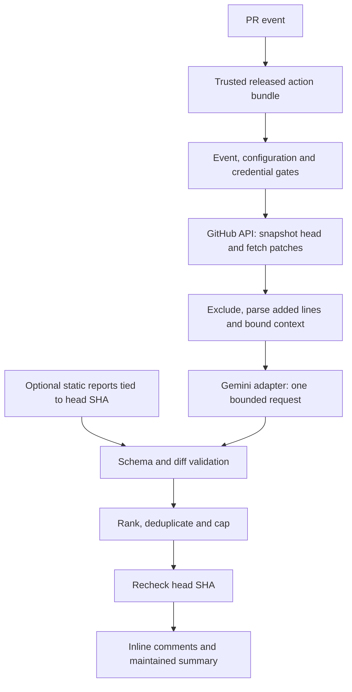

# Technical architecture — AI Code Review Action

**Version:** 0.2 · **Date:** 24 October 2026 · **Status:** Proposed

This document implements the intent of [the PRD](PRD.md). All components below are planned.

## 1. System and trust boundaries



The GitHub runner holds credentials, reads private patches, and publishes feedback. The provider receives only selected patch context and prompt instructions. No backend or database is needed. Existing bot comments provide persistence for rerun deduplication.

The reviewed repository and PR payload are untrusted inputs. The released action is trusted executable code. The implementation must never dynamically load code from the reviewed repository. Provider output is untrusted text and cannot initiate network calls, tool execution, file writes, or workflow changes.

## 2. Proposed code structure

```text
src/
  index.ts                    orchestration and top-level safe failure handling
  config.ts                   parse inputs and enforce limits
  types.ts                    shared review and result types
  github/
    client.ts                 API access and sanitized error mapping
    diff.ts                   pagination and unified patch parsing
    comments.ts               publish, reconcile and maintain summary
  security/
    exclusions.ts             path rules and credential-marker screening
  analyzers/
    static.ts                 optional static-report ingestion
  providers/
    types.ts                  provider-neutral request/response contract
    gemini.ts                 initial concrete adapter
  review/
    budget.ts                 serialized context and request limits
    prompt.ts                 instructions and untrusted-data framing
    validate.ts               runtime schema and added-line validation
    dedupe.ts                 stable fingerprints and existing-comment lookup
  telemetry.ts                count-only diagnostics
tests/
  fixtures/                   synthetic patches, events and provider responses
action.yml                    reusable action inputs and outputs
dist/                         bundled release entry point, generated later
.github/workflows/            development CI and trusted consumer example
```

Choose a currently supported GitHub JavaScript-action runtime and compatible bundler during M1. Compile and bundle dependencies for consumers so they do not build the reviewed repository to run the action. Verify release-bundle/source parity in CI.

## 3. Component contracts

```typescript
export type Severity = 'critical' | 'high' | 'medium' | 'low';

export interface Finding {
  path: string;
  line: number; // Positive line number on the added/right side of this diff.
  severity: Severity;
  message: string;
  recommendation: string;
}

export interface ReviewInput {
  files: ReadonlyArray<{ path: string; patch: string }>;
  maxFindings: number;
  language: string;
}

export interface ProviderResult {
  findings: Finding[];
  usage?: { inputTokens?: number; outputTokens?: number };
}

export interface AIProvider {
  review(input: ReviewInput, signal: AbortSignal): Promise<ProviderResult>;
}

export interface ReviewOutcome {
  status: 'completed' | 'partial' | 'skipped' | 'failed';
  reasonCode?: string;
  reviewedFiles: number;
  publishedFindings: number;
}
```

Validate provider responses at runtime; TypeScript alone does not validate network data. `recommendation` makes actionable advice mandatory, replacing the optional suggestion in the original starter. Provider-specific credentials, model configuration, token limits, and transport stay inside adapter construction.

## 4. Collection and context selection

1. Validate event type, repository identity, draft state, required inputs, and opt-in before provider work.
2. Snapshot base/head SHAs and paginate the files endpoint. Stop safely if the API cannot provide a complete file inventory; report incomplete coverage.
3. Normalize paths without permitting absolute paths or traversal. Apply built-in deny patterns plus user exclusions. Overrides cannot re-include mandatory secret exclusions in the MVP.
4. Skip removed files, binaries, missing patches, and patches whose hunk counts cannot be reconciled. Renames with usable patches use the new path. A patch can be structurally valid while omitting other content, so do not claim complete coverage from parsing alone; check available API change counts too.
5. Parse hunk headers and advance old/new counters separately. Only `+` content lines enter the eligible added-line set; context and removed lines cannot receive findings. Treat file headers and no-newline markers separately.
6. Sort eligible paths and include whole patches within configured limits. Measure the complete serialized provider payload, including instructions and metadata. Use conservative token estimates or provider token counting if available without violating request policy.
7. Preserve the same included-file set for provider input and validation. Report skipped counts and reason categories; avoid exposing secret-like file names in logs.

Treat code as quoted data in the prompt. Request only evidence-based findings from supplied context and permit an empty findings list. Prompt framing reduces injection risk but is not a complete defense; capability restrictions and output validation enforce the boundary.

## 5. Validation and publication

- Reject unknown paths, non-integer or non-positive lines, lines outside the included added-line set, unknown severities, missing recommendations, oversized strings, and malformed structures.
- Reject or sanitize unsafe rendered content such as unwanted mentions, raw HTML, and uncontrolled links. Never execute model-supplied content.
- Validation confirms shape and location, not factual truth. Measure semantic quality through labeled demo review.
- Rank critical → high → medium → low, then path and line. Cap after validation and deduplication.
- Generate a fingerprint from repository, PR number, path, line, and normalized explanation/recommendation. Persist a versioned marker on bot-authored inline comments. Exclude SHA from the exact fingerprint to suppress unchanged reruns across commits; moved lines or reworded findings may still produce new comments, which is a documented MVP limitation.
- Paginate existing review comments. Trust markers only on the expected bot author's comments. Track summary identity separately with a versioned marker on a bot-owned issue comment.
- Recheck head SHA immediately before publishing; discard stale findings. Attach review comments to the captured commit and right-side line. A race can still occur after the recheck; handle GitHub validation failures without retargeting to a newer commit.
- Use a comment review event, never approval or request-changes. Maintain one summary with coverage, outcome, capped/skipped counts, usage when available, and limitations. Do not overwrite human comments or remove discussion threads.
- After an ambiguous write failure, reconcile existing markers before retrying publication. Do not blindly repost a batch. Serialize runs per repository/PR in the consumer workflow; document that independent workflows can still race.

## 6. Static checks

Running repository linters can execute scripts, plugins, or configuration. Therefore the credential-bearing AI job only consumes bounded reports; it does not run ESLint, RuboCop, Brakeman, or Checkov itself.

Checks run in separate jobs without AI credentials, with minimized GitHub permissions and no persisted checkout credentials. Their reports must identify the producing workflow/run and head SHA. Reject stale or unrelated reports; enforce file-size, record-count, path, and schema limits. Do not extract arbitrary archives or evaluate report content. Initial supported formats are selected and documented during M5, with one fixture per claimed adapter.

Only static findings on eligible changed lines become inline feedback. An unavailable tool or report is reported as skipped, not as a clean scan. Other independent project CI checks may fail; the AI action remains advisory.

## 7. Configuration and outputs

| Input | Contract |
| --- | --- |
| `github-token` | Required for API access; supplied from an Actions secret |
| `provider` | `gemini` initially; unsupported values safely stop before requests |
| `model` | Explicit provider model identifier; no silent substitution |
| `provider-api-key` | Secret; masked before any diagnostics |
| `allow-external-provider` | False by default; explicit opt-in required for Gemini |
| `max-files`, `max-file-bytes`, `max-input-bytes` | Positive bounded integers; defaults in PRD |
| `max-input-tokens`, `max-output-tokens` | Additional input estimate guard and enforced output cap |
| `max-requests` | Fixed maximum of one in the MVP |
| `max-findings` | Positive bounded integer; default 10 |
| `review-language` | English by default |
| `exclude-patterns` | Additional exclusions, with documented matching rules |
| `mode` | Only `comment` accepted |
| `static-report-paths` | Optional bounded local report inputs with verified provenance |

Outputs: `status`, `reason-code`, `reviewed-files`, `published-findings`, and usage counts when known. Never output credentials or raw model content. Add upper validation ceilings during M1 to prevent accidental effectively unbounded settings.

## 8. Failure behavior

| Condition | Behavior |
| --- | --- |
| Fork, draft, no eligible files | Skip; no provider request |
| Invalid config, missing key, absent opt-in | Skip with actionable sanitized reason |
| Provider timeout, quota response, transport error | No automatic retry/fallback; report incomplete review |
| Invalid provider response | Drop invalid content; report partial/failed review, never imply clean |
| Stale head | Discard results; next synchronize run reviews new head |
| GitHub read failure | Stop; do not review an unknown/incomplete snapshot |
| Partial publication or write denial | Report partial/failed outcome; preserve already published feedback |
| No permission to post summary | Use sanitized runner summary and outputs |
| Unexpected exception | Catch, sanitize, and report failed review status |

Expected review failures should not intentionally fail the action process. Document that branch-protection configuration, cancellation, runner failure, and separate CI remain outside this guarantee. Never represent an interrupted or skipped review as “no issues found.”

## 9. Recorded architecture decisions

| Decision | Reason | Tradeoff |
| --- | --- | --- |
| Bundled TypeScript action | One installable artifact, no hosted infrastructure | Release artifacts need verification |
| API-only diff access | Avoid executing reviewed code with credentials | Less context than a local checkout |
| Gemini first, adapter contract now | Small initial integration surface | Other providers require later implementation |
| Whole-patch budgeting | Preserve valid hunk/line mapping | Large files receive no AI coverage |
| GitHub comments as state | No database | Pagination, concurrency, and wording changes limit deduplication |
| Separate static jobs | Keep executable tooling away from AI secrets | Artifact provenance and ingestion add work |
| One request, no automatic retries | Predictable maximum calls per run | Transient failures require a deliberate rerun |

## 10. Verification strategy

Unit-test parsing, exclusions, budgets, schema validation, fingerprinting, and sanitization. Use fake GitHub/provider clients for end-to-end orchestration, permissions, pagination, head changes, ambiguous writes, and failures. Use synthetic secret sentinels to verify logs and outbound exclusion. Run the fixed live evaluation corpus only after explicit provider configuration and budget controls are in place. Verify current GitHub/provider documentation when choosing runtime/API versions during implementation.
