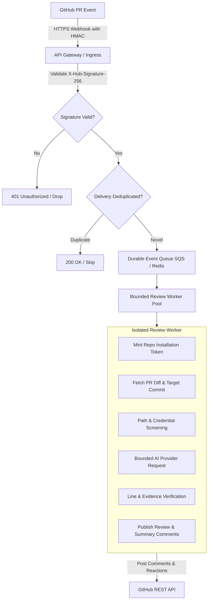

# GitHub App Architecture, Rollout, and Delivery Design

This document details the architectural design, client experience, security model, and rollout strategy for a centrally managed, CodeRabbit-style hosted GitHub App, while contrasting it with the existing GitHub Action.

---

## 1. Action vs. Hosted App: Architectural Comparison

The project currently provides a **GitHub Action** (`v0.2.13` / `v1`). The proposed **Hosted GitHub App** provides a zero-workflow, centrally updated SaaS experience.

| Dimension | GitHub Action (Working Today) | Hosted GitHub App (Proposed Architecture) |
| :--- | :--- | :--- |
| **Execution Environment** | Client's GitHub Actions runner (hosted or self-hosted) | Centrally hosted multi-tenant backend (Cloud Run / AWS ECS / Fargate) |
| **Workflow Setup** | Requires `.github/workflows/review.yml` in each repository | **Zero workflow files**; 1-click installation on GitHub Org/Repo |
| **Secrets Management** | Client stores `AI_PROVIDER_API_KEY` in repo secrets | Central secure vault (KMS / AWS Secrets Manager); zero client keys needed |
| **Updates & Maintenance** | Client tracks release tags (`@v1`) or SHA pins | **Centrally deployed & updated**; zero client maintenance |
| **Runner Minutes Cost** | Consumes client's GitHub Actions minutes | **Zero runner minutes** used in client repositories |
| **Trigger Mechanism** | GitHub Actions workflow triggers (`pull_request`, `issue_comment`) | GitHub Webhook delivery (`X-Hub-Signature-256`) to central API gateway |
| **Bot Identity** | Standard `github-actions[bot]` | Verified GitHub App identity (e.g. `ai-code-reviewer[bot]`) |
| **Status & Readouts** | Action console logs + PR comments | PR comments + GitHub Checks API status badges |

---

## 2. Client Experience

### 2.1 Onboarding & Installation
1. **1-Click Install:** An organization owner or repository admin navigates to the GitHub App listing and clicks **Install**.
2. **Repository Selection:** The client chooses whether to enable the App for **All repositories** or **Selected repositories**.
3. **Instant Activation:** Once installed, the App begins monitoring pull requests immediately. No `.github/workflows` file is required.

### 2.2 Configuration Management
- **Safe Defaults:** Works out of the box with balanced, cost-effective defaults (1 AI request, 12,000 input token budget, medium+ severity, comment-only).
- **In-Repo Preferences:** Teams can optionally supply repository-level review guidelines by committing:
  - `.github/ai-review.md` (or `.github/ai-review.yml`)
  - Supported options include custom instructions, path exclusions, minimum severity threshold, and enabled languages.
- **Interactive Commands:** Developers interact naturally on PRs:
  - `/review` — Forces a full fresh review on the current PR head.
  - `/review src/auth/login.ts` — Targets review to an exact file.

---

## 3. Hosted Service Architecture & Webhook Pipeline



### 3.1 Step-by-Step Processing Flow
1. **GitHub Webhook Dispatch:** GitHub delivers an event payload (`pull_request.opened`, `synchronize`, `reopened`, or `issue_comment.created`) to the central HTTPS endpoint.
2. **Signature Validation:** The API Gateway validates `X-Hub-Signature-256` using the App's configured webhook secret and HMAC-SHA256. Unsigned or mismatched requests are rejected with HTTP 401.
3. **Delivery Deduplication:** The gateway checks `X-GitHub-Delivery` against an in-memory or Redis sliding window to discard redelivered webhooks.
4. **Durable Queuing:** Valid events are enqueued onto a durable queue (AWS SQS FIFO or Google Cloud Tasks) partitioned by `repository_id:pull_number` to guarantee ordered, serialized PR processing.
5. **Worker Execution:**
   - Mentions and commands are screened for authorization.
   - An ephemeral, scoped installation token is minted for the target repository.
   - PR diffs are fetched at the exact immutable commit SHA.
   - The bounded review engine analyzes eligible files, queries the AI provider, validates line mappings and evidence, and posts comments.

---

## 4. Security, Token Lifecycle, and Multi-Tenant Isolation

### 4.1 Permissions Requested by the GitHub App
The App requests the minimum necessary permissions:
- `pull-requests: write` — Fetch pull request metadata, diffs, and publish inline review comments and summary reports.
- `contents: read` — Read immutable file blobs at specific commit SHAs for bounded import context; read repository review configuration files (e.g., `.github/ai-review.md`).
- `issues: write` — Handle `/review` comment triggers and acknowledge requests with emoji reactions (`eyes`, `rocket`).

### 4.2 Installation Access Token Lifecycle
- The App authenticates using an RS256-signed JSON Web Token (JWT) minted with the App's private key (maximum 10-minute lifetime).
- The JWT is exchanged via GitHub API (`POST /app/installations/{installation_id}/access_tokens`) for an **Installation Access Token** scoped strictly to the repository where the event originated.
- Tokens expire in 1 hour and are discarded in ephemeral memory immediately when the worker completes.

### 4.3 Tenant Isolation
- **No Shared State:** Workers process jobs in isolated sandbox containers. Memory and temp disk are wiped between tasks.
- **Quota & Rate Ceilings:** Each installation has isolated rate counters to ensure that one high-volume customer cannot starve another.
- **Provider Isolation:** Central provider API keys are injected via KMS/Secret Manager into workers without logging or exposing credentials.

### 4.4 Data Retention & Privacy
- **Zero Source Retention:** Diff contents and code lines are processed exclusively in volatile memory and never persisted to a database or disk storage.
- **No Model Training:** AI provider integrations enforce enterprise zero-data-retention agreements where code inputs are not retained or used for training.
- **Telemetry Sanitization:** Operational metrics store only hashes, token counts, file counts, and durations. Source code, diff hunks, prompts, and raw API responses are never logged.

### 4.5 Uninstall & Revocation Cleanup
- Upon receiving `installation.deleted` or `installation_repositories.removed` webhooks:
  - Active queued jobs for the installation are cancelled.
  - Cached tenant preferences and review checkpoints are immediately purged from Redis.

---

## 5. Central Updates, Rollout & Rollback Strategy

A major benefit of the GitHub App model is seamless, zero-maintenance updates for clients:

### 5.1 Update Compatibility Guarantees
- **Compatible Configuration Defaults:** Engine updates must remain backward-compatible with existing client configuration files (`.github/ai-review.md`).
- **No Breaking Output Schemas:** Markdown comment formats and checkpoint markers must retain backward compatibility with previously posted comments.

### 5.2 Staged Rollout Pipeline
Central backend deployments follow progressive delivery:
1. **Internal Canary:** Tested first against internal dogfooding repositories.
2. **Staged Production (Canary 5% → 25% → 100%):** Deployed gradually across installation cohorts while monitoring error rates, webhook latency, and provider timeout rates.
3. **Automated Rollback:** If the error rate exceeds 1% or provider rate limits spike, the deployment automatically rolls back to the prior release.

### 5.3 Permission Escalation Protocol
- If a future feature requires additional GitHub permissions, GitHub requires the organization administrator to explicitly approve the updated permission grant before the App can access it.
- The App must degrade gracefully if a client has not yet accepted new optional permissions.

---

## 6. Action Alternative: Release Management Strategy

For teams that prefer running in their own GitHub Actions runners without relying on a hosted service, the Action provides two distinct update models:

### 6.1 Maintained Moving Release Tag (`@v1`)
- **How it works:** Point your workflow to `@v1` (e.g. `uses: Ananthang/ai-code-review@v1`).
- **Client benefit:** Automatically receives compatible bug fixes, performance improvements, and prompt refinements without manually editing workflow YAML files.
- **Maintainer guarantee:** Breaking configuration changes or permission shifts will never be pushed to `@v1`.

### 6.2 Immutable Full-SHA Pinning (`@<commit-sha>`)
- **How it works:** Point your workflow to an audited, full commit SHA (e.g. `uses: Ananthang/ai-code-review@4726077...`).
- **Client benefit:** Maximum security and immutability for enterprise audit requirements. Third-party code cannot change without an explicit pull request.
- **Update process:** Use tools like Dependabot or Renovate to submit PRs updating the action commit SHA.

### 6.3 Client Upgrade & Deprecation Notification Strategy
When a new major version or critical upgrade is released (e.g. `v1` to `v2` or retirement of legacy models):
1. **In-Band PR Summary Alert Banner:**
   The action prominently renders an `[!IMPORTANT]` banner directly inside the PR review summary comment using `upgrade-notice` (or environment variable `AI_UPGRADE_NOTICE`). Because developers and maintainers actively read PR review comments, this provides 100% visibility right where they work.
2. **Workflow Annotations (`core.notice`):**
   The action registers a notice on the GitHub Actions workflow run and PR Checks tab, signaling CI engineers that an upgrade is recommended.
3. **Automated Dependency PRs:**
   Standard Semantic Versioning tags allow GitHub Dependabot and Renovate to open automated 1-click update PRs for maintainers.

---

## 7. Recommended Client Workflow Template

For clients running the GitHub Action, this workflow safely handles both automated PR reviews and manual `/review` commands **without executing untrusted PR code**:

```yaml
name: AI Code Review
on:
  pull_request:
    types: [opened, synchronize, reopened]
  issue_comment:
    types: [created]

permissions:
  contents: read

concurrency:
  group: ai-review-${{ github.event.pull_request.number || github.event.issue.number }}
  cancel-in-progress: true

jobs:
  review:
    # Run on eligible PRs or authorized /review comments
    if: >-
      (github.event_name == 'pull_request' &&
       github.event.pull_request.head.repo.full_name == github.repository &&
       !github.event.pull_request.draft) ||
      (github.event_name == 'issue_comment' && github.event.issue.pull_request &&
       (github.event.comment.body == '/review' || startsWith(github.event.comment.body, '/review ')))
    runs-on: ubuntu-latest
    timeout-minutes: 3
    permissions:
      contents: read
      pull-requests: write
      issues: write

    steps:
      - name: Run AI Code Review
        # Use @v1 for automatic compatible updates, or pin to an audited commit SHA
        uses: Ananthang/ai-code-review@v1
        with:
          github-token: ${{ secrets.GITHUB_TOKEN }}
          provider: ${{ vars.AI_PROVIDER || 'gemini' }}
          model: ${{ vars.AI_MODEL }}
          provider-api-key: ${{ secrets.AI_PROVIDER_API_KEY }}
          allow-external-provider: 'true'
          incremental: 'true'
          min-severity: 'medium'
          require-evidence: 'true'
```

> [!IMPORTANT]
> This workflow NEVER checks out or executes code from the pull request head in the privileged runner environment. All diff inspection occurs via read-only GitHub API calls.
